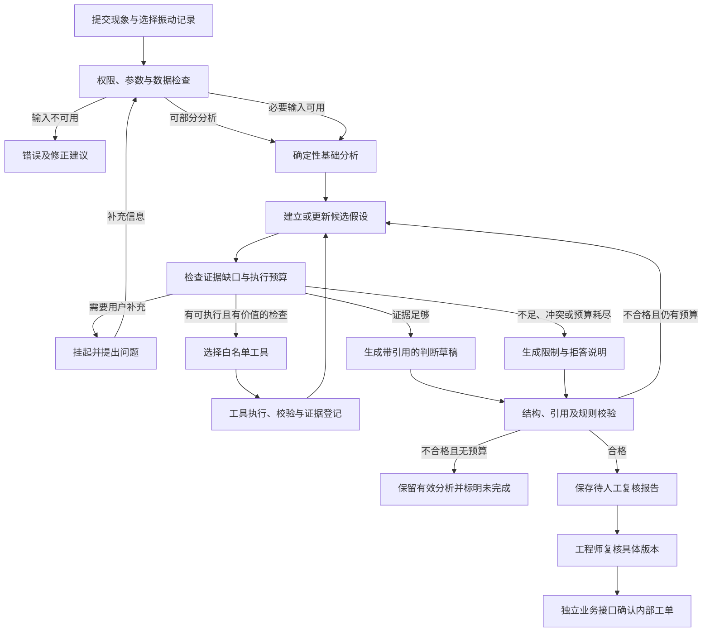
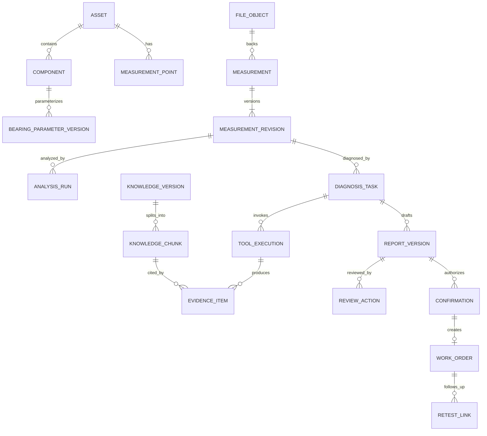
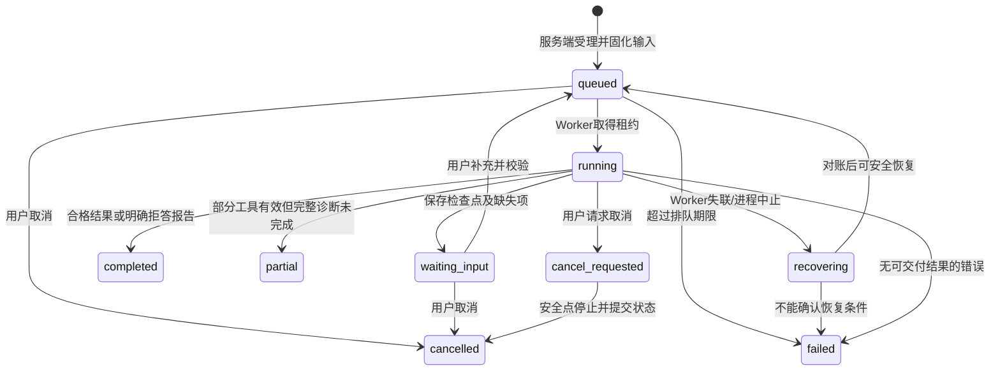
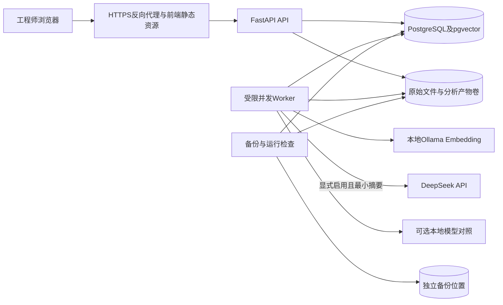

# 02 总体设计

> 版本：v0.3（完整总体设计及工程结构草案，待评审）
> 上游：[需求规格 v0.9](01-requirements.md)
> 状态：总体目标设计；M1本机数据基础已验收，M2工具详细设计已成稿，正式工具/Agent及完整试用能力仍待实现。具体DDL、schema和算法配置以相应阶段详细设计落实。

## 1. 架构目标

VibraDiag 是以工业诊断 Agent 为核心的全栈应用。前端用于提交任务、观察分析并复核证据；后端提供可信数据和确定性工具；Agent 决定当前任务还需要什么证据，并在受约束范围内选择下一步。

首发采用模块化单体、单机部署，API与耗时任务Worker独立进程，共用领域服务和数据库。模型推理服务独立接入，不先拆微服务。前期优先实现Agent闭环，台账、权限和工单保持首发必要范围。

## 2. 模块划分

| 模块 | 职责 | 不承担的职责 |
| --- | --- | --- |
| Web 工作台 | 上传、对话、图表、候选、工具进度、证据与复核 | 不在浏览器生成权威诊断或决定权限 |
| 业务 API | 身份/资源校验、数据关联、任务提交、结果读取、报告与确认写入 | 不依赖模型判断访问权限 |
| 分析工具层 | 质量检查、时域/频谱、包络、理论频率与峰匹配、可比记录查询 | 不靠模型计算数值、不直接发布维修工单 |
| Agent 编排层 | 澄清、假设、下一工具决策、冲突检查、终止与诊断草稿 | 不执行任意代码、不持有自主业务写权限 |
| 知识检索层 | 文档版本与审核、权限过滤、检索、块定位 | 不把相似文档当作当前设备测量事实 |
| 证据与发布校验 | 证据版本、适用条件、引用校验、报告版本与人工确认约束 | 不以模型自报高分代替有效性校验 |
| 持久化与运行支撑 | 文件、元数据、任务状态/检查点、审计、备份与配置 | 不用浏览器缓存代替任务事实 |

前期重点是分析工具、Agent 和最小工作台；完整业务权限与运行保障在共享试用前完成。存储模型从开始保留组织/用户、对象版本和来源，不因阶段后置而省掉边界。

## 3. 一次诊断的主流程



图中的“选择下一工具”由模型在工具描述、参数约束、候选和证据摘要基础上提出结构化请求，执行前由代码再次校验。工具缺少前置条件时不执行，不用模型补造参数。

工单不属于自主诊断循环。报告拒答、未复核、版本失效或审批未完成时，独立业务接口阻止创建。

## 4. 体现 Agent 能力的分支

| 观察或条件 | 合理的路径示例 | 验收关注点 |
| --- | --- | --- |
| 参数齐全且频谱出现待解释成分 | 根据候选请求包络或对应谐波检查 | 选择理由与证据缺口对应，不无差别执行所有工具 |
| 缺少本次采集转速 | 完成基础分析，追问转速；未知则限制依赖转速的任务 | 不用额定转速静默补齐 |
| 多个候选频率重合 | 请求能够区分假设的额外检查；不能区分则拒绝定类 | 保留反对证据与歧义 |
| 有历史记录但工况不同 | 先检查可比性，不直接算维修效果 | 工具前置条件有实际作用 |
| 无可靠知识命中 | 使用已有工具证据说明限制，不伪造手册引用 | RAG 为辅助知识，不强行命中 |
| 已无新信息或预算耗尽 | 保存有效结果并停止取证 | 不无限循环，也不自动变成“正常” |

这些是评测案例方向，不是固定的故障决策表。具体证据规则和频谱阈值需要独立定义、版本化并验证。

## 5. 状态与职责原则

- 分开管理对话会话、诊断任务、工具执行、证据、报告和工单；会话结束不等于全部对象完成。
- 诊断任务绑定数据/参数/知识/模型配置快照。用户修改依据后创建新版本或新任务，旧执行仍可追溯。
- 模型负责提出假设、选择工具、解释结果和请求补充；代码负责数值、条件校验、预算、权限、引用有效性及写入约束。
- 挂起等待用户不占用持续运行的工作进程；恢复后继续累计预算。执行中取消、失败与重启恢复在后续状态设计中明确处理。
- 工具执行记录既有业务可读摘要，也保留脱敏参数与结果引用；前端展示实际调用，不生成用于装饰的假轨迹。
- 前端通过任务状态和事件获取进度，断线后可从服务端重建；具体采用轮询或事件流在 API 设计中确定。

## 6. 技术选型与取舍

以下是试用版设计选型；安装前锁定具体补丁版本、兼容依赖和镜像digest，不把候选能力当成已验证实现。

| 部分 | 选型 | 原因与边界 |
| --- | --- | --- |
| API与领域服务 | Python 3.11、FastAPI、Pydantic | 与信号分析共用语言，输入/输出有结构校验；不在HTTP请求中同步等待整个诊断 |
| 分析 | NumPy、SciPy | 数值计算独立验证；保留算法版本与处理参数 |
| Agent | LangGraph、PostgreSQL持久检查点适配 | 支持有界循环、挂起和恢复；检查点不代替业务事务和审计 |
| 数据库 | PostgreSQL 17、版本化迁移工具 | 统一元数据、权限、业务、任务队列、审计；避免原型JSON文件充当共享数据库 |
| 向量检索 | pgvector，首发按权限过滤后的精确余弦检索 | 当前知识规模先以正确性和简单运维为主，不先引入独立向量数据库或ANN索引 |
| 任务执行 | 独立Worker、PostgreSQL任务表与租约 | 首发计算/诊断并发总计2，有界队列20；不引入Redis/Celery作为必需组件 |
| 文件与产物 | 本地持久数据卷＋数据库索引 | 通过存储接口封装；小规模先不引入对象存储服务 |
| 前端 | Vue 3、TypeScript、Element Plus、ECharts | 与原始技术方向一致，适合表单、分析图和证据工作台；现有手写HTML仅作原型验证，不作为最终前端 |
| 通用模型 | 默认DeepSeek Flash API，保留模型适配层 | 用户指定API；已验证工具调用与JSON模式。模型别名、响应model及prompt版本分别记录 |
| Embedding | 本地Ollama BGE-M3 567M；Qwen Embedding保留对照 | 依据开发对比暂留，避免占用云端数据通道；正式语料评测后再确认 |
| 部署入口 | Docker Compose＋反向代理/TLS | 单机可部署；外部暴露范围与证书在部署配置中明确 |

不首发引入独立分类网络、微调流程、reranker、Redis、消息中间件、微服务网关、地图或3D大屏。后续只有验证发现瓶颈或需求必要时再引入。

已运行的原型及本机模型对比见 [模型选型记录](appendices/model-selection.md)。本机原型曾测试的FastAPI/LangGraph版本不自动成为试用版锁定版本，持久化组件兼容性须重新核对。

## 7. 领域对象与版本

### 7.1 通用约定

- 所有业务对象使用服务端生成的稳定ID；单组织部署仍保留 `organization_id`，从认证上下文注入，不由模型/浏览器决定。
- 时间使用UTC语义存储，页面按配置时区显示；采集、上传、运行、确认时间分别记录。
- 不可变输入/报告内容以版本行保存；可变状态保留 `row_version` 作乐观并发校验。改变物理解释的修正创建新版本，不覆盖旧值。
- 设备与文件“来自哪个工厂”的展示名不是可信事实证明；测试/公开/仿真/现场导入来源类型显式记录。
- 大波形、完整频谱和图像存数据卷，数据库保存校验值、位置、大小与格式；图状态只保存引用，不塞入完整采样数组。

### 7.2 核心对象

| 对象/建议表名 | 关键数据及关系 | 版本与约束 |
| --- | --- | --- |
| organizations、users、role_assignments | 用户、组织、角色、设备范围、授权状态 | 管理角色不隐含工程审批权；停用保留历史身份 |
| assets、components、measurement_points | 设备、目标部件、测点及方向 | 标识唯一；引用后只停用，显示名可修正并留痕 |
| bearing_parameter_versions | 型号、几何参数/频率系数、运动学假设、来源和核对人 | 绑定部件；数值修改新建版本，不能猜厂家参数 |
| file_objects | 存储对象ID、内容SHA256、大小、存储键、状态 | 不用用户文件名作路径；相同物理内容不共享访问权限 |
| measurements | 原始采集记录、上传者、来源类型、原文件引用 | 一个CSV对应单测点单方向通道，允许先未关联 |
| measurement_revisions | 单位、采样率、转速/负载、采集时间、关联及各字段来源 | 不可变快照，parent_revision可追溯；额定值与本次值分别保存 |
| analysis_runs | 输入revision、片段、算法及配置版本、执行结果和产物 | 同配置可复用有效产物，但每次用户执行有独立记录 |
| conversations、conversation_messages | 用户对话和关联任务、消息来源 | 对话不是所有业务对象的唯一容器；更新参数由显式操作生效 |
| diagnosis_tasks、task_attempts | 任务目标、输入与配置快照、预算、运行/取消状态 | 一个任务可多次执行尝试；改核心输入则建新任务并关联旧任务 |
| tool_executions、model_invocations | 工具/模型请求、版本、执行ID、时延/用量、响应引用 | 模型请求与重试分开记；未知计费/版本不伪造 |
| evidence_items、evidence_relations | 测量/知识/前置条件证据，来源、主张及支持/反对关系 | ID可解析到精确版本，派生证据记录共同上游 |
| task_events | 任务内单调序号、状态和阶段摘要、关联执行ID | 用于恢复页面和审计关联，不保存内部思维链 |
| report_versions、review_actions | 七块结构、事实引用、限制、人工改动、复核记录 | 诊断生成草稿与人工复核分开；已发布内容不可覆盖 |
| confirmations、idempotency_records | 已确认报告、动作摘要、审批、有效期、请求哈希 | 服务端验证、绑定具体版本；保存成功结果供重试查询 |
| work_orders、work_order_events | 手工确认的动作、责任人、状态、执行及关闭理由 | 一确认不得重复生成工单；变更动作重新审批 |
| retest_links | 工单与前后measurement_revision、可比性及复测分析 | 复测是独立记录，不自动复制原记录充当复测 |
| knowledge_documents、knowledge_versions、knowledge_chunks | 来源/适用范围/审核状态、文本位置、版本与权限 | 发布版本不可变；撤回保留历史定位 |
| embedding_index_versions、chunk_vectors | 模型digest、维度、预处理、语料版本与向量 | 不同模型向量不能混搜，即使同为1024维 |
| audit_events、configuration_versions | 操作者、对象、变更、原因、配置摘要 | 应用只追加审计；密钥只留引用/状态，不入普通版本记录 |

### 7.3 关系与约束



关系图展示主要业务关联，实际DDL还需包含组织、权限、可空关联和复测revision外键。数据量大的文件与数组不是数据库外键对象的直接替代。

必须建立的约束：

- `task_events(task_id, sequence)` 唯一；追加与对应业务状态变更在同一事务提交。
- `tool_executions(task_id, logical_call_key)` 唯一；工具配置和输入指纹变化必须产生新key。
- 工单的 `confirmation_id` 唯一；幂等键作用域至少包含组织、操作者与操作类型，并绑定请求体哈希。
- 台账标识与所有关联必须在同组织中有效；通用UUID不能替代授权校验。
- 报告/工单引用的旧版本不得级联物理删除；原始文件缺失或hash不一致时标记不可验证。

### 7.4 文件与数据库的一致性

先将上传写入服务控制的暂存目录，限制大小、流式计算hash、校验内容，再原子落到生成的存储键。数据库事务登记 `ready` 对象及采集记录；失败产物保留待清理标记，不暴露为有效数据。

文件系统与数据库不具有天然共同事务。定期扫描未引用暂存物和缺失文件，只有符合保留策略的孤立暂存物可清理，已被报告引用的数据不自动删除。恢复演练检查数据库行与文件hash的双向对应。

## 8. 工具契约与证据规则

### 8.1 统一调用契约

模型可见参数只包含业务ID与受限配置，不接受任意本地路径、SQL、Python代码、URL或直接数组上传指令。

每次调用由执行器补入 `organization_id`、`actor_id`、`task_id`、`logical_call_key`、输入revision、算法/配置版本、超时与追踪ID；这些字段不信任模型自行提供。

统一输出：

| 字段 | 含义 |
| --- | --- |
| status | `ok`、`unavailable`、`invalid_input`、`failed`、`cancelled` |
| tool_execution_id / tool_version | 实际执行身份和版本 |
| input_fingerprint | 数据revision、片段与配置的规范化指纹 |
| facts | 结构化数值/条件事实，含单位、适用范围、来源属性 |
| artifact_refs | 频谱、波形、图表等产物的受控引用 |
| evidence_ids | 通过有效性校验后登记的证据 |
| limitations / missing_requirements | 分析限制和缺失条件，不混入测量结果 |
| error_code / retryable | 脱敏错误分类与是否允许重试 |
| metrics | 开始/结束、耗时、版本与可获知用量 |

模型供应商的 `tool_call_id` 单独保存，用于保持工具会话协议；它不等于业务 `logical_call_key`。超出本轮预算的每个工具请求仍须返回对应的未执行结果，不能留下供应商会话缺少响应的调用。

### 8.2 工具目录

| 工具 | 核心输入 | 前置条件和输出 |
| --- | --- | --- |
| inspect_quality | measurement_revision、质量配置 | 单位/采样参数/数据完整性检查，给质量事实与限制；不自动证明传感器好坏 |
| analyze_time_domain | revision、片段、配置 | RMS、AC RMS、峰值等，全部绑定数值定义与单位 |
| analyze_spectrum | revision、片段、窗与标定配置 | 完整可追溯幅度谱及结构化峰值；不自动命名故障 |
| analyze_envelope | revision、滤波频段/版本、有效片段 | 检查带宽/长度/边界要求，返回有效段、包络谱和限制 |
| calculate_bearing_frequencies | bearing_parameter_version、转速来源/值 | 返回理论值、运动学假设、原始参数，不能用型号猜缺失参数 |
| match_frequency_evidence | spectrum_ref、frequency_result_ref、匹配配置 | 峰匹配、偏差、局部噪声、谐波/边带及歧义；检查两结果是否来自兼容条件 |
| compare_measurements | 前后revision、可比性配置 | 先验证设备/测点/方向/工况/处理条件，返回对比或不具可比性 |
| retrieve_knowledge | 问题、当前目标/假设、已授权范围 | 已发布且有权的块版本与定位；无命中和语义冲突明确表达 |
| get_authorized_history | 当前设备、任务限定时间/类型 | 只读的历史报告/工单/复测摘要；不默认获取全部设备记录 |

原型中的 `inspect_spectrum`、`check_bearing_preconditions`、`search_knowledge` 是可行性验证名称，后续由版本化工具注册表映射或迁移，不将原型工具直接当完整目录已实现。

### 8.3 事实、假设和自然语言分开

- 工具数值形成 `fact_id`；例如RMS数值来自计算，rpm可能来自用户填写，两者来源类型不同。
- Agent输出采用“候选假设ID＋支持/反对fact或evidence引用＋缺口＋下一检查”，不自由重新生成测量数字。
- 报告指标卡和数值表由代码按事实渲染；模型只解释已引用事实。引用必须语义相关，不能用一个有效ID为任意文字背书。
- 所有确定性诊断须经过版本化证据规则检查；模型提出的支持等级只有通过必要条件、有效证据种类及冲突检查才可进入待复核报告。
- 模型称“测得转速”、推断未检查频率不存在、仅凭正常RMS断言健康等案例纳入语义测试。原型的关键词和存在性检查只是初步防线，不能代替完整语义校验。
- “JSON格式正确”“证据ID存在”“数值/来源一致”“文本受证据支持”“诊断有效”是不同验收层次，分别记录。

### 8.4 失败与重试

| 分类 | 例子 | 行为 |
| --- | --- | --- |
| INPUT_INVALID | 非法单位、损坏CSV | 不调用模型，提示修正 |
| PRECONDITION_MISSING | 缺转速、轴承参数 | 只暂停依赖任务，允许已有基础分析 |
| OUT_OF_SCOPE | 变速或未验证设备 | 说明范围，不强制归类 |
| TRANSIENT_DEPENDENCY | API限流、短时断网 | 预算内最多一次自动重试，记录实际尝试 |
| AUTH_OR_BILLING | API认证、余额、权限撤销 | 明确失败，不自动改模型或切换外发方式 |
| OUTPUT_INVALID | 结构、引用、来源不符 | 最多一次反馈修正；仍不合格保留分析并拒绝发布判断 |
| CONFLICTING_EVIDENCE | 支持与反对无法化解 | 继续有价值检查或停止并说明不确定 |
| BUDGET_EXHAUSTED / CANCELLED | 达到时限/次数、用户取消 | 停止新调用，保存有效阶段结果与终态 |

算法阈值和匹配容差在详细设计中以配置版本定义，使用开发/验证集确定；总体设计不编造一套未经评测的通用工业阈值。

## 9. Agent状态、队列与恢复

### 9.1 三种状态不混用

1. 执行状态：任务现在是否排队、运行、挂起或结束。
2. 分析结果：支持某假设、存在异常但不确定、未发现目标故障证据、无法分析/范围外。
3. 报告状态：草稿、待复核、已复核、被替代/撤回。

`completed` 不代表设备正常；`waiting_input` 不等于进程仍在运行；“已复核”也不等于维修已执行。



`completed` 中可以包含正确拒答；`partial` 包含模型不可用但基础计算成功等情况。终态任务不直接回到运行；显式重试创建新attempt，核心输入改变则创建关联的新task。

### 9.2 图状态

持久图状态包含：任务/会话ID、输入revision与配置快照、必要信息槽位及来源、候选假设、证据引用、缺失项、实际工具计划、模型消息摘要/引用、剩余预算、挂起原因和已完成逻辑步骤。

数值数组、密钥、完整知识库不放入图状态。`thread_id` 由服务端按任务生成，不直接采用用户传入的字符串作为跨用户会话指针。图状态访问和恢复同样执行权限校验。

节点划分为：校验输入、基础分析、建立/更新假设、证据缺口评估、模型计划、执行与登记证据、冲突评估、生成草稿、发布前校验和保存待复核结果。预算与权限在节点外层执行器统一检查。

### 9.3 挂起与输入修订

使用持久检查点保存等待位置，再通过受控恢复命令提交用户输入。挂起节点恢复可能从节点开头重新运行，因此挂起前不得进行未幂等的业务写操作，参考官方中断语义。[LangGraph中断](https://docs.langchain.com/oss/python/langgraph/interrupts)

- 补充此前未知但不推翻已有工具依据的信息，可登记新的上下文快照后恢复并验证哪些产物仍可用。
- 更改单位、采样率、原文件、测点或目标轴承等核心解释条件时，旧任务保持原快照并标为被新任务替代；新任务重新执行依赖步骤。
- 参数补充与修订均有操作者、来源和版本；不能让用户在普通聊天里一句“改成另一个文件”就跳过权限和数据选择。
- 人工等待不占用Worker和活动执行时间，但端到端业务历时另记。预算累计，不因多次恢复归零。

### 9.4 单机执行策略

- API提交任务与队列条目同一事务落库，立即返回202和任务ID。数据库锁保护“最多20个等待任务”的检查与插入，避免并发超额受理。
- Worker短事务使用 `FOR UPDATE SKIP LOCKED` 领取可运行任务，提交后才执行耗时工作；不能整个模型调用期间持有数据库行锁。该机制适用于队列领取，不作为普通业务查询的一致性替代。[PostgreSQL说明](https://www.postgresql.org/docs/17/sql-select.html)
- 首发2个执行槽位为基础分析/诊断共享上限；知识索引低优先级单独受限，不与前台任务无限抢CPU。单机数据库配置行和租约共同约束槽位，不仅依赖每个进程的本地锁。
- 每次租约分配递增 `lease_epoch`，默认10秒心跳、60秒失联判定；具体值在故障注入时调整。只有当前epoch可提交有效状态与结果。
- 排队默认最多等待10分钟后进入明确失败；排队时间计入诊断时延统计。人工等待不使用此排队过期规则。
- 自动执行预算按需求：最多8轮取证、20次工具调用、累计活动执行120秒、调用最多一次自动重试。原型的2轮预算是实验设置，不直接替代试用配置。
- 单次调用超时取配置上限与剩余任务预算较小者。取消后不再启动新调用；已发外部请求可能继续计费，不能承诺取消即停止供应商计算。

### 9.5 检查点与业务记录的一致性

LangGraph检查点用于恢复图执行位置；业务表保存产物、报告和授权事实，二者不天然共享一次提交。[LangGraph持久化](https://docs.langchain.com/oss/python/langgraph/persistence)

采用“可重入节点＋业务执行账本＋恢复对账”：

1. 执行前按任务、工具、输入与配置生成稳定逻辑key，登记执行意图。
2. 工具产物验证后，由持有有效租约的Worker在一个业务事务中登记结果/证据和完成事件。
3. 节点返回引用，再由持久检查点记录图状态。若第2步成功而第3步失败，重放节点先查执行账本并返回同一有效结果，不重复登记。
4. 若产物生成但未登记，不能当作任务成功；恢复时校验后认领或记孤立产物，只有当前epoch可以发布。
5. 模型请求超时且无法确定供应商是否已处理时记录“响应未确认”。重试可能重复费用，不宣称外部推理恰好一次；业务副作用仍由独立幂等接口保护。
6. 领取到过期任务先核对检查点、账本、取消状态、权限和预算。可安全恢复则续跑，否则标中断/失败并允许显式重试。

本设计不承诺所有计算恰好执行一次，而是允许安全重放，并保证已确认工单等受事务保护的业务写入不重复。

## 10. RAG与模型适配

### 10.1 知识发布链路

上传MD/TXT → 内容校验及净化 → 文档版本 → 按标题/段落切块并保留定位 → 生成向量 → 工程审核 → 原子发布索引版本。

首发切块目标约200—400个中文字符，避免拆开参数条件和结论；超长段落按句切分，必要时保留小段重叠。字符长度只是初始策略，另按实际模型token上限检查，不能静默截断。切块策略及版本随语料清单保存，最终依据检索测试调整。

索引完成但审核未通过时不可正式检索；新版本失败不覆盖旧已发布版本。撤回禁止新任务使用，同时给已引用报告增加提示。运行任务发现引用被撤回/权限变更时，暂停相关推理并重新核对，不能用锁定快照绕过当前访问控制。

### 10.2 检索范围与索引迁移

- 查询由当前问题和任务目标生成，组织、权限、设备适用范围与发布状态由服务端过滤。
- 首发过滤后做精确向量排序，返回最多5块及来源定位；不先全库检索再靠前端隐藏越权内容。
- 嵌入索引身份包含模型digest、输出维度、预处理/查询指令和语料版本；仅维度相同不代表可复用旧向量。
- 更换Embedding或切块策略时建立新索引、执行对比验收后切换默认；原任务保留已用块版本。迁移失败保持原索引可用。
- 不同向量空间与配置分开存储/查询；未来规模需要ANN时须重新验证权限过滤后的召回与隔离，不能只测全库速度。[pgvector说明](https://github.com/pgvector/pgvector)
- 无可靠命中返回明确空结果；相关性阈值由验证集决定，不直接拿固定余弦值当诊断可信概率。混合检索与reranker后续根据失败案例决定，不为技术展示先加。

### 10.3 通用模型适配

统一模型接口接受：受约束消息、白名单工具schema、输出契约、超时/预算和模型配置引用；返回文本/工具请求、供应商调用ID、请求模型/实际model、结束原因和usage。

Ollama原生schema与DeepSeek JSON object模式分别适配，应用始终本地校验；供应商未提供保证时不标成严格schema执行。工具ID、参数序列化和工具结果消息在适配层处理，不污染领域工具。

外部请求仅包含当前任务必要信息。特征摘要、用户描述、授权知识仍属于可能敏感内容，是否可外发由部署配置及业务授权决定；缺省不外发原始文件/完整波形。密钥保存在环境/受控密钥文件中，模型配置版本只保存引用，前端不持有。

API错误不返回认证头或原始供应商正文；固定官方地址或管理员受控白名单，不提供用户任意URL调用。默认模型不可用时明确失败/降级，不偷偷换成本或外发边界不同的模型。

## 11. 报告、审批与工单事务

### 11.1 报告生成和复核

工具事实形成结构化报告内容，模型解释单独保留，七个报告区块通过服务端组装。未满足确定性判断规则时只允许限制/拒答报告；报告结构完整不等于诊断正确。

复核人可以接受、修改或退回，关键修改生成新版本，并标明人工补充的事实和理由。禁止修改已复核版本正文；新版本通过复核后显式替代旧版，相关旧确认作废，但原已生成工单仍保留历史依据并标出变更。

### 11.2 确认对象

确认凭据使用高熵随机值，服务端只存校验摘要；默认10分钟有效，可配置。绑定组织、报告版本、设备、动作哈希、优先级、确认/审批人、权限版本及到期时间。凭据不放URL、日志、模型上下文或长期浏览器存储。

普通/低优先级由工程师确认；高/紧急另经主管审批。角色由服务端验证；不假定两个步骤必须不同自然人，但同账号需明确同时拥有相应角色，轨迹分别记录。

### 11.3 创建工单的事务

1. 验证当前账号和设备范围；查询幂等记录。若相同作用域/键已成功且请求哈希一致，返回原工单；同键不同请求返回409。
2. 对确认与报告相关行加锁，校验版本、审批、有效期、动作、撤权和报告是否被替代；不能依赖客户端confirmed布尔值。
3. 同事务消费确认、插入具有唯一confirmation_id的工单、追加工单事件/审计和幂等成功结果，再提交。
4. 唯一约束冲突时读取同一成功结果；事务失败不留下已消费却无工单的确认。
5. 响应丢失后可用幂等键查回结果；成功重放不创建新工单，即使原确认之后过期。读取原结果仍须当前权限，撤权者不能靠幂等键取业务内容。

工单后续状态转换也校验 `row_version` 和权限；改动作需新确认/审批，不能用普通编辑接口绕过。关闭未复测工单需主管及“未验证”理由。

## 12. API与前端边界

以下是目标路由分组，不是宣称已实现的API；详细schema与状态码在实施前写入OpenAPI并与前端类型同步。

| 目标接口 | 核心行为 |
| --- | --- |
| POST /api/v1/auth/login；POST /logout；GET /me | 服务端登录会话、退出与权限摘要 |
| /api/v1/assets、/components、/measurement-points | 授权台账列表、详情、版本化修改与停用 |
| POST /api/v1/measurements | 上传并建立采集记录；返回校验/关联状态 |
| GET /measurements/{id}；POST /{id}/revisions | 读取受控记录、创建参数/关联新版本 |
| POST /api/v1/analysis-tasks | 异步提交基础/专项分析，返回202与任务ID |
| POST /api/v1/conversations；POST /{id}/messages | 保存用户消息和显式输入提议，不直接修改已确认业务记录 |
| POST /api/v1/diagnosis-tasks | 按输入revision及目标创建诊断任务 |
| GET /tasks/{id}；GET /{id}/events | 读取任务状态与单调序号事件；按after_sequence增量轮询 |
| POST /tasks/{id}/resume；POST /{id}/cancel；POST /{id}/retry | 校验当前状态、权限与输入版本，有幂等键 |
| GET /api/v1/evidence/{id}；GET /artifacts/{id} | 受权证据/图表/原文定位；不接受任意存储路径 |
| /api/v1/reports；POST /{id}/reviews；POST /{id}/exports | 报告版本、复核与受控导出 |
| POST /api/v1/confirmations；POST /{id}/approvals | 动作确认与高优先级审批，不向Agent开放 |
| POST /api/v1/work-orders；POST /{id}/transitions；POST /{id}/retests | 幂等创建、手工状态与复测关联 |
| /api/v1/knowledge；POST /{id}/publish；POST /{id}/withdraw | 文档版本、索引任务、审核发布及撤回 |
| /api/v1/admin/users、/configurations、/audit-events | 受角色限制的配置与审计；密钥只可写入/替换，不回显 |
| /health/live；/health/ready | 进程存活与可用能力，公开响应不暴露密钥/内部配置 |

原型 `/api/analyses` 和 `/api/diagnoses` 后续迁移为版本化异步接口；迁移前保留实验复现方法，不把同步原型模式带入共享试用。

### 12.1 通用HTTP约定

- 使用服务端会话及HttpOnly、Secure、SameSite Cookie；状态改变请求校验CSRF，默认同源部署，不开放任意来源CORS。
- 202代表任务已受理而非分析已完成；422为参数/内容错误，413超限，401/403认证/授权，404不存在或不可披露对象，409状态/版本/幂等冲突，429容量限流，503依赖不可用。
- 错误响应包含稳定错误码、用户可读说明和request_id；日志保存受控内部上下文，不向页面返回堆栈或真实密钥。
- 资源更新使用版本前提；副作用请求带Idempotency-Key。列表分页并限制每页上限，导出单独检查权限和资源预算。
- 进度首发采用约1秒增量轮询，可退避到5秒；断线后根据最后序号补齐。SSE为后续可替换传输，不改变事件事实。

### 12.2 最终前端的信息架构

主入口为“诊断工作台”，围绕一次任务呈现，而不是以通用后台菜单为核心。

| 区域 | 内容与交互 |
| --- | --- |
| 输入与对话 | 现象、数据选择、参数来源、待补充问题；高风险修改显式确认 |
| 分析视图 | 时域/频谱/包络、片段和参数、单位与质量提示；图表和证据联动 |
| 取证面板 | 候选假设、支持/反对/缺失证据、当前工具及执行结果 |
| 结论与复核 | 待复核草稿、分析限制、人工修改、版本差异和业务确认 |
| 记录入口 | 设备/文件/报告/工单的轻量列表与筛选，不做通用ERP |
| 管理入口 | 知识、用户/授权、配置、审计和备份状态；依角色显示但仍由后端强制权限 |

当前手写HTML验证页不作为最终视觉方案。最终页面在接口与状态稳定后做线框和交互设计，包含空、加载、部分完成、超时、撤权、等待输入和恢复状态；不能把错误隐藏在工具JSON里。

## 13. 访问控制与审计边界

- 登录身份、组织、角色、设备范围和资源关系由领域访问服务判断；所有文件/知识/证据读取与导出复用相同授权规则。
- 未关联记录仅上传者及明确授权工程师可读；关联设备不得自动扩大原有文件访问范围。后台Worker使用有范围的任务授权，不是无限管理员身份。
- 任务受理、每个敏感读取节点、恢复及业务写入重新检查撤权/停用状态；历史配置快照不能冻结访问权限。
- 系统管理员能运行备份等敏感运维动作，但业务读取和工程复核需另外授权；不能宣称数据库超级管理员绝无读取能力。
- 知识审核权限独立授予工程角色；模型只读已发布且可访问内容。知识中的命令、脚本和外链没有执行权限。
- 审计记录与业务变更同事务提交。应用数据库账号对审计只插入/查询，不更新/删除；运维迁移另用受控账号，重大维护留单独记录。
- 密钥轮换不写入审计正文或配置导出，只记谁在何时更新了哪个引用。业务报告、日志、备份及云端请求按各自数据边界处理。

## 14. 部署、可观测与备份

### 14.1 目标单机拓扑



API、Worker用相同应用镜像但不同入口；前端构建为静态资源，模型服务可复用宿主机或独立服务。仅代理业务端口面向授权网络，数据库与Ollama不默认对外暴露。

DeepSeek模式需要批准的网络出口，不能声称该模式断网仍可完成Agent推理。隔离内网可用确定性分析及显式配置的已验证本地模型；本地模型目前仅为对照，未通过正式诊断准入，不能把原型对照直接宣布为离线等效替代。

### 14.2 运行监测

按request_id、task_id、attempt_id、tool_execution_id贯通日志。监测：队列等待/长度、阶段耗时、工具成功率、模型调用/重试与token、拒答原因、无效输出、内存/磁盘和Worker心跳。

分别统计计算完成、结构通过、语义评审通过和业务完成，避免仅凭HTTP200报成功。费用只在单价来源及版本明确时估算并标估算，不把未知usage记为0。

取消/超时、API认证/余额错误、磁盘不足、原文件缺失、知识索引失败与报告引用失效须在页面有可读状态。日志轮转与容量监测避免耗尽业务数据卷。

### 14.3 备份与回退

- 数据库、原文件、产物、审计、配置引用和知识来源作为一份恢复集合，生成manifest和hash；索引可以重建但不可丢来源版本。
- 首发每日及人工备份窗口采用短时应用写入屏障：暂停新受理与副作用写入，让当前提交到安全点，取得数据库一致快照和对应文件清单；完成后解除。运行请求可继续只读查看，必要暂停明确显示。
- 文件集合按备份manifest复制到独立存储位置，期间不物理清理被引用对象。失败备份不标成功；密钥通过独立受控流程恢复，不随普通业务导出明文分发。
- 独立实例恢复后检查关系、文件hash、幂等记录、任务状态与权限，重建必要索引。恢复后先停止Worker和外部业务写入，完成对账再开放，防止旧任务重复执行或旧确认被重放。
- 升级前执行备份与迁移检查，失败优先使用已验证的兼容回退或恢复整套升级前状态，不承诺随意反向执行数据库迁移。
- RPO≤24小时、RTO≤4小时按需求容量实测；同机副本不能当防整机损毁方案，正式试用须有可用独立备份位置。

## 15. 需求映射、实现差距与后续产出

### 15.1 需求追溯

| 需求 | 主要设计落点 | 主要验收 |
| --- | --- | --- |
| D 数据导入 | 7.2/7.4文件与revision、12上传接口 | AT-01/08/09 |
| E 设备与工况关联 | 7版本模型、8前置条件、13授权 | AT-02/08 |
| A1 澄清 | 3主流程、9挂起/恢复、12工作台 | AT-02/03/07 |
| A2/A4 数值与轴承取证 | 8工具/事实契约、7产物版本 | AT-01/03/12 |
| A3/A5 Agent | 8规则/失败、9状态/预算、10模型适配 | AT-03/07/12 |
| B 证据/拒答/报告 | 8.3分层验证、11报告、12复核视图 | AT-03/05/08 |
| C 工单/复测/审计 | 7引用、11事务、13审计 | AT-05/06/08 |
| F 知识库 | 10知识发布、索引版本和授权检索 | AT-04/09/12 |
| G/H 权限及工作台 | 12 API/界面、13访问策略 | AT-06/09/13 |
| I及非功能 | 9执行恢复、14部署/备份/监测 | AT-07/10/11 |

版本计划再把每个故事和非功能条目映射到具体任务/测试ID，本表不代替逐条验收。

### 15.2 原型与目标的差距

| 当前已验证 | 仍需实现/验证 |
| --- | --- |
| 单列CSV、基础指标和幅度谱 | 文件/参数数据库版本、完整质量与资源边界 |
| 简短LangGraph工具循环 | 持久检查点、Worker队列、取消恢复与对账 |
| DeepSeek工具调用和JSON校验 | 正式事实/语义/诊断规则及大规模任务评测 |
| 开发知识卡片向量检索 | 文档导入、审核、权限过滤、版本化pgvector索引 |
| 独立Vue3/TypeScript原型工作台 | 最终视觉/多页面业务工作台及完整交互/可用性验收 |
| 原型基础自动测试 | 身份授权、并发幂等、报告复核、工单及复测 |
| 本机开发运行 | Compose部署、升级回退、独立备份、压力/故障恢复与现场适用核对 |

### 15.3 下一文档

阶段划分已写入 [03版本计划与验收](03-milestones.md)：按“数据基础 → 工具与证据 → Agent闭环 → 工作台/知识 → 业务复核 → 试用保障”分配可验收版本，并安排跨阶段权限/版本/恢复约束的实现依赖。

M1数据基础、正式前端与显式原型迁移已通过本机阶段验收，见[记录](acceptance/M1-acceptance.md)和[操作指南](05-m1-local-guide.md)。M2工具设计见下文，正式工具实现仍待推进。当前单进程中断标记不等于M3的Worker/持久队列；原型诊断不自动成为正式结果，完整试用能力仍待M2—M6实施。

M2-T01现已形成[06轴承工具详细设计](06-m2-tool-design.md)，下一步先实现数值模块；本设计中的完整工具目录不是当前已开放接口清单。

## 16. 修订与资料

| 版本 | 日期 | 内容 |
| --- | --- | --- |
| v0.1 | 2026-10-29 | 架构边界、Agent主流程与能力分支；历史原文见附录 |
| v0.2 | 2026-10-29 | 增加选型、领域模型、工具/证据契约、执行恢复、RAG、审批事务、API/前端、权限、部署备份及需求映射 |
| v0.3 | 2026-10-29 | 将可运行原型迁为backend/src分层后端与独立Vue前端，加入版本化路由、服务/存储端口和独立构建/测试命令 |

- [总体设计v0.1原文](appendices/system-design-v0.1.md)
- [需求规格](01-requirements.md)
- [模型选型与实测](appendices/model-selection.md)
- 上述LangGraph/PostgreSQL/pgvector官方资料支持设计机制，不能代替本项目实际兼容和故障恢复测试。

## 17. 工程包结构与依赖方向

本节17.1—17.4保留v0.3工程分离时的结构/22项测试快照。M1后新增的身份、正式采集/分析和前端实际状态见工作区README及M1记录，不以该历史树作为当前功能全量清单。

采用单仓库、前后端独立工程、后端模块化单体。不存在所有公司通用的唯一目录规范；本项目按职责、依赖方向、可独立测试和部署边界组织，而非按目录数量判断成熟度。

### 17.1 后端当前结构

```text
backend/
├─ pyproject.toml
├─ requirements.lock.txt
├─ .env.example
├─ src/vibradiag/
│  ├─ main.py
│  ├─ api/
│  │  ├─ dependencies.py
│  │  ├─ errors.py
│  │  ├─ router.py
│  │  └─ v1/{analyses,diagnoses,knowledge}.py
│  ├─ schemas/requests.py
│  ├─ services/
│  │  ├─ analysis_service.py
│  │  ├─ diagnosis_service.py
│  │  ├─ knowledge_service.py
│  │  ├─ execution_gate.py
│  │  └─ ports.py
│  ├─ domain/errors.py
│  ├─ analysis/signal.py
│  ├─ agents/{graph,contracts}.py
│  ├─ infrastructure/
│  │  ├─ llm/{router,deepseek,ollama}.py
│  │  ├─ retrieval/vector_index.py
│  │  └─ persistence/local_repository.py
│  └─ core/{config,paths}.py
├─ tests/{unit,integration}/
└─ scripts/
```

- main只装配应用和全局边界；api解析HTTP并调用服务，不直接计算FFT、发供应商请求或写业务文件。
- services实现用例，存储通过Protocol端口调用；具体存储在装配入口注入。当前检索/模型适配保持轻量，后续出现多个生产实现时再扩展必要接口。
- domain不依赖FastAPI或供应商SDK。当前仅有实际使用的错误对象；设备/报告等领域模型和ORM表在对应需求实施时加入，不创建假实体填目录。
- analysis是可独立验证的确定性工具；agents管理图与输出契约，不与HTTP请求schema混用。
- infrastructure封装供应商协议、当前文件存储和开发索引。JSON与NPZ只是原型适配，并未因此完成PostgreSQL/pgvector迁移。
- core统一后端.env与工作区运行数据路径，避免因包迁移将数据写入src目录或找不到密钥。

### 17.2 前端当前结构

```text
frontend/
├─ package.json / package-lock.json
├─ vite.config.ts / tsconfig.json
├─ index.html
└─ src/
   ├─ main.ts / App.vue
   ├─ components/
   ├─ composables/useWorkbench.ts
   ├─ api/client.ts
   ├─ types/api.ts
   └─ styles/main.css
```

前端组件不直接访问数据库或供应商；HTTP调用在api客户端统一处理，交互状态在composable中管理，模型密钥不进入前端工程或构建产物。前端可独立类型检查和构建，不需要启动Python才能打包。

多页面路由、布局和全局账号状态在相应功能实施时加入router/views/layouts/stores等目录，不为展示架构先创建无人使用的空包。Element Plus/ECharts仍为正式工作台的设计选型，本轮只迁移原型交互，尚未引入它们，也未完成最终视觉设计。

### 17.3 本轮接口和启动边界

- 前端开发入口5173，后端API入口8010；Vite仅代理/api和/health，浏览器保持同源请求。
- 当前可运行路由迁为 `/api/v1/analyses`、`/api/v1/diagnoses`、`/api/v1/knowledge/search` 和 `/api/v1/samples/sine.csv`；仍是原型同步任务，不等于第12节的异步队列已实现。
- 后端根路径返回服务信息，`/docs`提供API文档，不再由FastAPI直接托管原型HTML。前端构建生成独立dist，生产时由同源反向代理提供资源和API转发。
- 根scripts/dev.py仅组合启动两个独立进程；两工程仍可分别启动和部署。后端通过editable安装导入src包，不依赖业务脚本临时修改sys.path。
- 本地.env迁到backend，旧位置不留副本；历史原型API/HTML保存在research，不是备用生产入口。
- 数据和实验位置保持稳定，旧实验的历史源码hash/路径不改写；新的测试脚本记录新路径，保证目录调整不会伪造旧实验。

完整启动、测试命令与目录树见 [工作区说明](../README.md)、[后端说明](../backend/README.md)、[前端说明](../frontend/README.md)。本轮重构改变代码组织与开发边界，不宣称新增了账号权限、工单或生产部署能力。

### 17.4 重构核对

后端editable安装及22项测试通过；前端TypeScript检查与生产构建通过；浏览器经5173代理完成CSV上传、刷新读取、知识检索和真实DeepSeek工具调用，相关API均返回200，缺转速被正确展示为需要补充信息。

前端源码及构建产物纳入当前密钥匹配扫描，未发现匹配。浏览器截图尝试超时，未把截图作为视觉验收依据；本轮记录的是交互、DOM和网络验证，不是最终界面设计验收。

浏览器验证原始结果保存在 `research/separated-browser-result.json`。原型仍只在本机运行。
