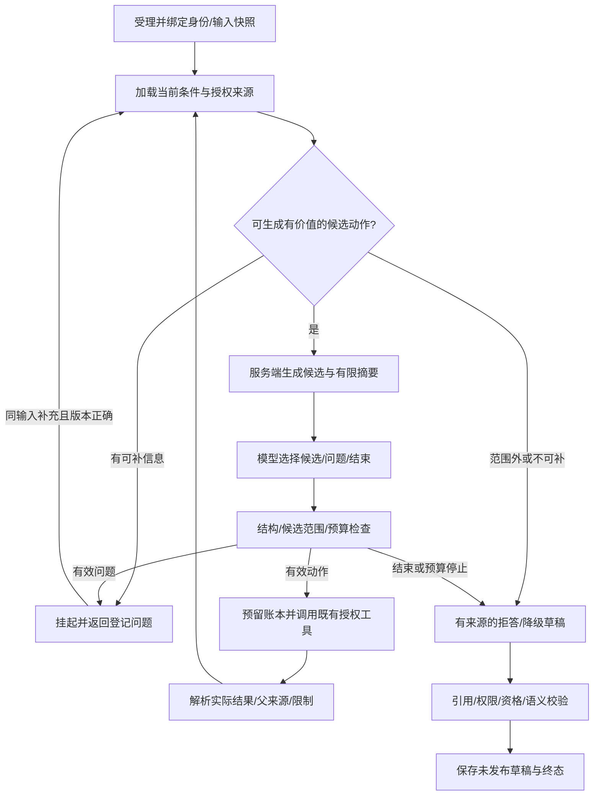

# 07 M3 Agent取证闭环详细设计

> 版本：v0.1，M3-T01设计与纯契约策略；日期：2026-10-30。
> 上游：[需求](01-requirements.md)、[阶段计划](03-milestones.md)、[M2总验收](acceptance/M2-acceptance.md)、[M2工具契约](contracts/m2-tool-contract.json)。
> 本轮仅实现DTO、纯策略与机器契约，不代表正式Agent、数据库任务、Worker、RAG或模型效果已实现。M2-R01—R04继续阻断正式诊断发布。

## 1. 目标与首轮范围

将模型从“读取一组结果后写文字”变成受限决策者：依据用户任务与已核验结果选择有价值的下一步；条件不足则澄清、降级或拒答。正式首轮只允许基础分析、探索包络/匹配、理想频率、条件比较、方法解释，不能输出确定性故障、健康、严重度、停机或维修有效结论。

M2分析工具和业务权限作为执行边界；DeepSeek提供动作建议和未发布草稿，LangGraph承载有界图；M3-T02提供持久任务和执行账本，T03接已发布知识，T04接正式模型外发与草稿校验，T05评测后决定范围。没有新增分类/Embedding模型或微服务的必要。

## 2. 当前原型与正式实现隔离

现有`agents/graph.py`属于M0实验：读取原型分析、调用开发知识索引、临时构造EV-001等ID，无正式授权来源和持久检查点。继续留在显式启用的模型实验入口，历史实验不覆盖。

新增`formal_contracts.py`和`formal_policy.py`不调用该原型、不自造证据、不读取文件/数据库或调用模型。正式图将在独立运行模块中接入服务。`docs/contracts/m3-agent-contract.json`导出本轮schema和预算，不能作为权限凭证。

## 3. 有界图与节点责任

模型不固定调用全部工具；其输出只有选择已登记动作、选择已登记问题、结束。服务端决定候选是否值得生成，例如基础数值已有授权结果时优先复用，缺rpm不阻止包络，缺不确定量不生成可执行匹配候选，比较条件不成立不强行跑差值。

模型最多提出下一步，不选择节点名、任意函数/参数、profile数值、URL、本地路径或SQL。候选变化会生成新ID，旧候选不能跨任务或输入快照使用。每次执行前与发布前都重新校验权限与当前输入。

## 4. 公共命令与服务端快照

计划接口，**本轮未开放**：

| 命令 | 最小请求与含义 |
| --- | --- |
| POST /api/v1/agent-tasks | goal、description、可选measurement_revision_id；比较额外绑定comparison_declaration_id；Idempotency-Key |
| GET /agent-tasks/{id} | 当前身份下的状态、已完成事实摘要、问题/限制和草稿；不是检查点/任意消息转储 |
| POST /agent-tasks/{id}/resume | expected_version、question_id、answer；新操作幂等键，核对原任务/挂起问题和当前会话 |
| POST /agent-tasks/{id}/cancel | expected_version；阻断后续调度与完整草稿发布，不撤销已完成只读计算 |

goal包括inspect_signal、bearing_observations、compare_measurements、explain_method。前三种必须有明确输入版本；比较还需受控声明，模型不能替用户登记。纯方法解释可以没有振动输入。

组织、发起人、会话、请求版本、预算/模型配置、候选动作和内部thread_id由服务器注入。description/answer是待分析数据，不能覆盖工具权限。自然语言补充转速/单位只能成为待核对线索；修改测量参数须通过既有版本/确认流程，不能从聊天直接改台账。

同键同请求返回原任务，同键不同请求409。现有输入确认可以由服务端解析当前发起人的有效记录；没有确认就登记问题或请求用户完成确认，模型不能代确认。比较同时检查两份输入和两个本人确认。

## 5. 状态、挂起与输入修订

状态包括queued、running、waiting_information、completed、completed_degraded、refused、failed、cancelled、interrupted、superseded、budget_exhausted、timed_out。completed表示首轮探索任务完成，不表示完成故障诊断；completed_degraded保留模型/知识不可用等具体原因和确定性结果。

| 事件 | 规则 |
| --- | --- |
| 缺可补充信息 | 等待已登记question_id，不占用Worker或数据库长事务 |
| 同输入有效回答 | 核对expected_version、组织/操作者/会话与问题状态后恢复；预算沿用 |
| 输入revision/context/声明关键绑定变化 | 旧任务superseded，新任务另建并记录parent_task_id；不让旧证据经过“重新核对” |
| 问题来自其他任务/版本 | 404或409，不按问题文本近似匹配恢复 |
| 撤权/确认失效/来源损坏 | 停止相关执行/发布，保留历史失效原因；不借缺参列表泄漏其他组织信息 |
| 取消与完成竞态 | 用状态版本/租约令牌事务围栏；迟到响应只能记录已完成调用，不能覆盖取消终态 |

问题模板和缺失字段代码来自服务端，模型只能选择该次可用question_id。回答不自动满足专业来源、公差或诊断资格门槛；无法补齐时允许明确拒答，不无界重复追问。

## 6. 工具候选、身份与幂等

正式动作包括读取既有基础分析、执行M1基础分析、M2四类工具、检索已发布知识。M2调用沿用其公共引用schema和授权服务；本轮没有把研究时间轴适配加入允许清单。

CandidateAction绑定任务、组织、一个输入（比较为两个）、候选种类及logical_call_key。具体payload由服务端保存，模型只返回candidate_id和简短理由。内部DTO的存在不证明已授权；T02必须从真实服务加载并校验，不能接受浏览器提交这些DTO。

logical_call_key由任务ID、规范输入fingerprint和服务端动作快照生成，独立于供应商tool_call_id。发起前预留账本，调用M1/M2时映射为固定幂等键；响应丢失先用原键查回。已有结果只有在权限/来源/确认仍有效时才能复用，模型不能靠ID绕过重读。

同任务对相同绑定/配置重复请求不重复计算；新增候选必须有新信息或不同的有用检查依据。数值unavailable不按失败自动重跑。认证/参数/越权/旧版本错误不自动重试，临时网络失败至多重试一次；429/503需尊重可用预算和退避，不忙等。

## 7. 预算与累计时间

采用agent-budget-v1：最多8个逻辑模型轮次、20次逻辑工具调用、每个外部逻辑调用最多1次自动重试、累计活跃执行120000ms。模型决策、草稿生成和格式修复都计入8轮；传输重试沿用原轮次，但记录真实attempt、耗时和用量。输出格式修复不是免费重试。

预留发生在外发/工具执行之前，失败或结果未知不退款。相同逻辑键重放不新增预留，但不能重新执行已消耗的调用。人工等待不算活跃执行；恢复不得重置计数/耗时。排队等待、活跃耗时及端到端总时长分别保存，未知模型用量或费用用null，不写0。

本轮ExecutionBudget为不可变纯DTO，reserve/charge校验不具备并发原子性。T02用数据库行锁/CAS事务提交预留和任务状态。Worker崩溃时按持久开始时间和调用超时保守计费/计时；无法判断的已发调用占位不能清除。120秒耗尽后禁止新增调度，已完成历史仍可授权读取。

## 8. 事实、知识与未发布草稿

引用使用kind＋真实UUID：basic_analysis、tool_run、fact、evidence、knowledge_chunk。禁止临时EV-001、自由编造ID或仅凭字符串存在认定有效。服务端解析到真实来源后，检查组织、输入根、权限、hash/确认/版本和知识发布状态。

numeric_fact只接受基础分析/事实；exploratory_observation接受工具运行/事实/探索证据；method_explanation只接受已发布知识片段。知识不能成为设备测量根，探索EV不能变成确诊依据，同源图不增加独立采集数。

首轮ExploratoryDraft只有analysis_only或insufficient_evidence，必须声明限制；信息不足必须列缺失项。输出始终unpublished_draft，不含故障类别、概率、严重度、停机或维修动作字段。结构/引用校验不等于语义验证：自由文本仍可能错误，T04需校验语义/数值并由服务端渲染关键事实，T05做独立拒答/可回答评测。当前纯策略检查不宣称已经解决幻觉。

## 9. LangGraph与持久执行边界

当前锁定langgraph 1.2.18。官方文档区分线程检查点与跨线程存储；内存checkpointer不构成跨重启恢复，见[Persistence](https://docs.langchain.com/oss/python/langgraph/persistence)。本项目业务任务、预算、权限及调用账本仍以PostgreSQL为权威，checkpoint只是运行光标。

[Interrupts](https://docs.langchain.com/oss/python/langgraph/interrupts)说明恢复会重新进入中断节点，因此中断前的外部副作用必须受账本/幂等保护。使用服务器生成thread_id，不能把知道thread_id当作授权。恢复数据先通过本项目schema和业务校验，再提交图恢复命令。

T02先验证PostgreSQL checkpointer与当前版本/角色兼容性，所有新增表由迁移身份创建，运行账号不自动DDL/setup。本轮没有安装新的checkpointer包、没有用MemorySaver假装正式持久化，也没有写入检查点表。

## 10. T02任务/Worker落地计划

拟新增agent_tasks、agent_calls、agent_events及恢复操作/检查点关系；完整DDL和编号留T02评审实施，当前head仍0012、27表。task保存绑定/状态版本/预算/发起会话，call保存逻辑键/attempt/工具执行ID及未知响应，event追加审计而非全量覆盖trace。

T02a先交付持久受理/挂起/恢复及进程内托管Worker，继续受现有单API租约和M1/M2共享并发2限制。Worker每步从可信任务绑定恢复当前principal，不保存用户明文cookie，不使用创建任务时缓存的角色代替当前授权；原会话过期需要重新登录并通过受控恢复重新绑定。

T02b再落实隔离执行/硬预算与完整取消。若拆为独立Worker进程，必须先提供跨进程总容量和受控委托身份协议，不能每个进程各开两个计算槽或直接绕过现有M2执行门槛。进程内软检查不能称硬超时。取消后正在完成的M2只读结果可留档，Agent发布必须受任务版本围栏限制。

## 11. RAG与模型承接

T03提供已发布MD/TXT版本、切块/来源、pgvector索引身份、权限/撤回过滤；默认最多5块，并限制摘要和上下文大小。开发知识卡片不自动成为正式知识，检索无命中可降级但不能补造KB引用。

T04默认复用DeepSeek API适配能力，但正式路径还需模型配置版本、外发许可、超时/重试分类、用量和结构/语义校验。默认外发必要文字与特征摘要，不发原CSV或完整波形，去除标签编码文件名、目录和金标。本文不把现有原型API成功当正式Agent准入。

## 12. 首批验证矩阵

| 用例 | 判定 |
| --- | --- |
| M3-T01-C01 | 公共命令不接受组织/角色/checked/预算/模型覆盖；目标和输入绑定一致 |
| M3-T01-C02 | 模型只能选择已登记候选/问题；跨任务、跨组织、错输入和重复候选被拒绝 |
| M3-T01-C03 | 8模型轮/20工具/1重试/120秒上限；预留不退款、序列化恢复不重置预算 |
| M3-T01-C04 | 引用须真实类型/UUID、组织/有效性/输入范围一致；知识不充当测量 |
| M3-T01-C05 | 草稿没有诊断/工单输出字段，保留限制；结构校验不宣称语义正确 |
| M3-T02后续 | 并发CAS、进程重启、旧租约、撤权/会话过期、未知响应对账及取消竞态实测 |
| M3-T03/T04/T05后续 | 真实知识/模型/图不同路径与固定任务评测，不以模拟schema测试冒充任务完成率 |

本轮只覆盖C01—C05的纯契约/策略用例，未来M3-AT01—AT05仍未通过。正式任务API、真实图取证和RAG尚不能从当前页面使用。

## 13. 实施顺序

1. T01：本设计、公共/内部DTO、纯预算/候选/引用检查和机器契约。
2. T02a：任务DDL、受理/查询/挂起/恢复、幂等账本及托管Worker，接M1/M2真实授权执行。
3. T02b：持久图检查点、故障恢复/对账、隔离/硬预算与取消，明确进程模型。
4. T03：正式知识发布、pgvector与权限检索。
5. T04：DeepSeek正式外发、结构/引用/语义及数值检查。
6. T05：固定案例的规则/单次模型/Agent对照，区分成功、拒答、降级、成本和未满足条件。

每一步独立记录实际测试与失败，保留M2条件；不通过增加管理页面代替Agent取证能力。
