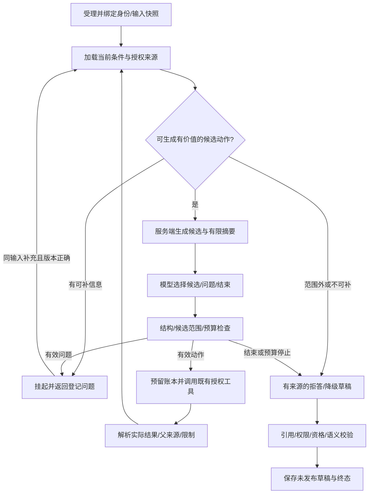

# 07 M3 Agent取证闭环详细设计

> 版本：v0.5，T02b3纯数值子进程、统一容量与可终止执行；日期：2026-10-30。
> 上游：[需求](01-requirements.md)、[阶段计划](03-milestones.md)、[M2总验收](acceptance/M2-acceptance.md)、[M2工具契约](contracts/m2-tool-contract.json)。
> T01已实现DTO、纯策略与机器契约；T02a已实现数据库任务、幂等命令、调用账本及托管规则执行器。T02b2已将新任务接入分步LangGraph持久规则图，RAG与DeepSeek决策仍未接入。M2-R01—R04继续阻断正式诊断发布。

## 1. 目标与首轮范围

将模型从“读取一组结果后写文字”变成受限决策者：依据用户任务与已核验结果选择有价值的下一步；条件不足则澄清、降级或拒答。正式首轮只允许基础分析、探索包络/匹配、理想频率、条件比较、方法解释，不能输出确定性故障、健康、严重度、停机或维修有效结论。

M2分析工具和业务权限作为执行边界；DeepSeek提供动作建议和未发布草稿，LangGraph承载有界图；M3-T02提供持久任务和执行账本，T03接已发布知识，T04接正式模型外发与草稿校验，T05评测后决定范围。没有新增分类/Embedding模型或微服务的必要。

## 2. 当前原型与正式实现隔离

现有`agents/graph.py`属于M0实验：读取原型分析、调用开发知识索引、临时构造EV-001等ID，无正式授权来源和持久检查点。继续留在显式启用的模型实验入口，历史实验不覆盖。

新增`formal_contracts.py`和`formal_policy.py`不调用该原型、不自造证据、不读取文件/数据库或调用模型。正式图将在独立运行模块中接入服务。`docs/contracts/m3-agent-contract.json`导出本轮schema和预算，不能作为权限凭证。

## 3. 有界图与节点责任

模型不固定调用全部工具；其输出只有选择已登记动作、选择已登记问题、结束。服务端决定候选是否值得生成，例如基础数值已有授权结果时优先复用，缺rpm不阻止包络，缺不确定量不生成可执行匹配候选，比较条件不成立不强行跑差值。

模型最多提出下一步，不选择节点名、任意函数/参数、profile数值、URL、本地路径或SQL。候选变化会生成新ID，旧候选不能跨任务或输入快照使用。每次执行前与发布前都重新校验权限与当前输入。

## 4. 公共命令与服务端快照

T02a已开放以下接口，路径统一以`/api/v1`开头；另有`GET /agent-tasks`本人授权分页列表。前端任务交互留后续阶段：

| 命令 | 最小请求与含义 |
| --- | --- |
| POST /api/v1/agent-tasks | goal、description、可选measurement_revision_id；比较额外绑定comparison_declaration_id；Idempotency-Key |
| GET /agent-tasks/{id} | 当前身份下的状态、已完成事实摘要、问题/限制和草稿；不是检查点/任意消息转储 |
| POST /agent-tasks/{id}/resume | expected_version、question_id、answer；新操作幂等键，核对原任务/挂起问题和当前会话 |
| POST /agent-tasks/{id}/cancel | expected_version；阻断后续调度与完整草稿发布，不撤销已完成只读计算 |

goal包括inspect_signal、bearing_observations、compare_measurements、explain_method。前三种必须有明确输入版本；比较还需受控声明，模型不能替用户登记。纯方法解释可以没有振动输入。

组织、发起人、会话、请求版本、预算/模型配置、候选动作和内部thread_id由服务器注入。description/answer是待分析数据，不能覆盖工具权限。自然语言补充转速/单位只能成为待核对线索；修改测量参数须通过既有版本/确认流程，不能从聊天直接改台账。

同键同请求返回原任务，同键不同请求409。现有输入确认可以由服务端解析当前发起人的有效记录；没有确认就登记问题或请求用户完成确认，模型不能代确认。比较同时检查两份输入和两个本人确认。

## 5. 状态、挂起与输入修订

状态包括queued、running、waiting_information、completed、completed_degraded、refused、failed、cancelled、interrupted、superseded、budget_exhausted、timed_out。completed表示首轮探索任务完成，不表示完成故障诊断；completed_degraded保留模型/知识不可用等具体原因和确定性结果。

| 事件 | 规则 |
| --- | --- |
| 缺可补充信息 | 等待已登记question_id，不占用Worker或数据库长事务 |
| 同输入有效回答 | 核对expected_version、组织/操作者/会话与问题状态后恢复；预算沿用 |
| 输入revision/context/声明关键绑定变化 | 旧任务superseded，新任务另建；parent_task_id关联留T02b；不让旧证据经过“重新核对” |
| 问题来自其他任务/版本 | 404或409，不按问题文本近似匹配恢复 |
| 撤权/确认失效/来源损坏 | 停止相关执行/发布，保留历史失效原因；不借缺参列表泄漏其他组织信息 |
| 取消与完成竞态 | 用状态版本/租约令牌事务围栏；迟到响应不能覆盖取消终态；T02a将未知调用保留为interrupted，已完成M1/M2只读来源可独立保留，完整对账留T02b |

问题模板和缺失字段代码来自服务端，模型只能选择该次可用question_id。回答不自动满足专业来源、公差或诊断资格门槛；无法补齐时允许明确拒答，不无界重复追问。

## 6. 工具候选、身份与幂等

正式动作包括读取既有基础分析、执行M1基础分析、M2四类工具、检索已发布知识。M2调用沿用其公共引用schema和授权服务；本轮没有把研究时间轴适配加入允许清单。

CandidateAction绑定任务、组织、一个输入（比较为两个）、候选种类及logical_call_key。具体payload由服务端保存，模型只返回candidate_id和简短理由。内部DTO的存在不证明已授权；T02必须从真实服务加载并校验，不能接受浏览器提交这些DTO。

logical_call_key由任务ID、规范输入fingerprint和服务端动作快照生成，独立于供应商tool_call_id。发起前预留账本，调用M1/M2时映射为固定幂等键；响应丢失先用原键查回。已有结果只有在权限/来源/确认仍有效时才能复用，模型不能靠ID绕过重读。

同任务对相同绑定/配置重复请求不重复计算；新增候选必须有新信息或不同的有用检查依据。数值unavailable不按失败自动重跑。认证/参数/越权/旧版本错误不自动重试，临时网络失败至多重试一次；429/503需尊重可用预算和退避，不忙等。

## 7. 预算与累计时间

采用agent-budget-v1：最多8个逻辑模型轮次、20次逻辑工具调用、每个外部逻辑调用最多1次自动重试、累计活跃执行120000ms。模型决策、草稿生成和格式修复都计入8轮；传输重试沿用原轮次，但记录真实attempt、耗时和用量。输出格式修复不是免费重试。

预留发生在外发/工具执行之前，失败或结果未知不退款。相同逻辑键重放不新增预留，但不能重新执行已消耗的调用。人工等待不算活跃执行；恢复不得重置计数/耗时。排队等待、活跃耗时及端到端总时长分别保存，未知模型用量或费用用null，不写0。

T01的ExecutionBudget为不可变纯DTO；T02a已用数据库行锁/CAS事务提交预留、调用账本和任务状态，预算不会因恢复而重置。Worker崩溃时按持久开始时间和调用超时保守计费/计时；无法判断的已发调用占位不能清除。120秒耗尽后禁止新增调度，已完成历史仍可授权读取。

## 8. 事实、知识与未发布草稿

引用使用kind＋真实UUID：basic_analysis、tool_run、fact、evidence、knowledge_chunk。禁止临时EV-001、自由编造ID或仅凭字符串存在认定有效。服务端解析到真实来源后，检查组织、输入根、权限、hash/确认/版本和知识发布状态。

numeric_fact只接受基础分析/事实；exploratory_observation接受工具运行/事实/探索证据；method_explanation只接受已发布知识片段。知识不能成为设备测量根，探索EV不能变成确诊依据，同源图不增加独立采集数。

首轮ExploratoryDraft只有analysis_only或insufficient_evidence，必须声明限制；信息不足必须列缺失项。输出始终unpublished_draft，不含故障类别、概率、严重度、停机或维修动作字段。结构/引用校验不等于语义验证：自由文本仍可能错误，T04需校验语义/数值并由服务端渲染关键事实，T05做独立拒答/可回答评测。当前纯策略检查不宣称已经解决幻觉。

## 9. LangGraph与持久执行边界

当前锁定langgraph 1.2.18。官方文档区分线程检查点与跨线程存储；内存checkpointer不构成跨重启恢复，见[Persistence](https://docs.langchain.com/oss/python/langgraph/persistence)。本项目业务任务、预算、权限及调用账本仍以PostgreSQL为权威，checkpoint只是运行光标。

[Interrupts](https://docs.langchain.com/oss/python/langgraph/interrupts)说明恢复会重新进入中断节点，因此中断前的外部副作用必须受账本/幂等保护。使用服务器生成thread_id，不能把知道thread_id当作授权。恢复数据先通过本项目schema和业务校验，再提交图恢复命令。

T02b1已安装锁定的官方PostgresSaver依赖，并在专用测试库的隔离schema验证跨进程持久化。所有验证表由迁移身份创建，应用身份不执行DDL/setup；验证schema结束时按标记删除，业务迁移仍0013/31表。T02b1当时未接业务；T02b2现已通过0014接入任务绑定与独立检查点schema，不使用MemorySaver替代跨重启恢复。

## 10. T02任务/Worker落地计划

T02a已新增agent_tasks、agent_commands、agent_calls、agent_events四表，head为0013_agent_tasks，共31张业务表。命令表保存受理/恢复/取消的幂等摘要；检查点表留T02b。task保存绑定/状态版本/预算/发起会话，call保存逻辑键/attempt/工具执行ID及未知响应，event追加审计而非全量覆盖trace。

T02a已交付持久受理/挂起/恢复及进程内托管规则Worker，继续受现有单API租约和M1/M2共享并发2限制。Worker每步从可信任务绑定恢复当前principal，不保存用户明文cookie，不使用创建任务时缓存的角色代替当前授权；原会话过期需要重新登录并通过受控恢复重新绑定。

T02b再落实隔离执行/硬预算与完整取消。若拆为独立Worker进程，必须先提供跨进程总容量和受控委托身份协议，不能每个进程各开两个计算槽或直接绕过现有M2执行门槛。进程内软检查不能称硬超时。取消后正在完成的M2只读结果可留档，Agent发布必须受任务版本围栏限制。

## 11. RAG与模型承接

T03提供已发布MD/TXT版本、切块/来源、pgvector索引身份、权限/撤回过滤；默认最多5块，并限制摘要和上下文大小。开发知识卡片不自动成为正式知识，检索无命中可降级但不能补造KB引用。

T04默认复用DeepSeek API适配能力，但正式路径还需模型配置版本、外发许可、超时/重试分类、用量和结构/语义校验。默认外发必要文字与特征摘要，不发原CSV或完整波形，去除标签编码文件名、目录和金标。本文不把现有原型API成功当正式Agent准入。

## 12. 首批验证矩阵

| 用例 | 判定 |
| --- | --- |
| M3-T01-C01 | 公共命令不接受组织/角色/checked/预算/模型覆盖；目标和输入绑定一致 |
| M3-T01-C02 | 模型只能选择已登记候选/问题；跨任务、跨组织、错输入和重复候选被拒绝 |
| M3-T01-C03 | 8模型轮/20工具/1重试/120秒上限；预留不退款、序列化恢复不重置预算 |
| M3-T01-C04 | 引用须真实类型/UUID、组织/有效性/输入范围一致；知识不充当测量 |
| M3-T01-C05 | 草稿没有诊断/工单输出字段，保留限制；结构校验不宣称语义正确 |
| M3-T02后续 | 并发CAS、进程重启、旧租约、撤权/会话过期、未知响应对账及取消竞态实测 |
| M3-T03/T04/T05后续 | 真实知识/模型/图不同路径与固定任务评测，不以模拟schema测试冒充任务完成率 |

T01覆盖C01—C05纯契约/策略用例；T02a新增真实数据库/API/工具/恢复验证，见[T02a记录](acceptance/M3-T02a-verification.md)。M3-AT01—AT05尚未整体通过；正式图取证和RAG未接入，任务API尚无工作台交互。

## 13. 实施顺序

1. T01：本设计、公共/内部DTO、纯预算/候选/引用检查和机器契约。
2. T02a：任务DDL、受理/查询/挂起/恢复、幂等账本及托管Worker，接M1/M2真实授权执行。
3. T02b：持久图检查点、故障恢复/对账、隔离/硬预算与取消，明确进程模型。
4. T03：正式知识发布、pgvector与权限检索。
5. T04：DeepSeek正式外发、结构/引用/语义及数值检查。
6. T05：固定案例的规则/单次模型/Agent对照，区分成功、拒答、降级、成本和未满足条件。

每一步独立记录实际测试与失败，保留M2条件；不通过增加管理页面代替Agent取证能力。

## 14. T02a规则执行与恢复边界

执行器显式返回`executor=rules_scaffold_v1`、`model_called=false`、`formal_graph_executed=false`。inspect_signal执行真实基础分析；bearing_observations按条件执行基础/包络/理论频率/匹配；compare_measurements仅接受受控双输入声明；explain_method因正式知识服务尚未接入而拒答，不拼接开发卡片。规则链不等于模型自主选择候选。

配置或目标有多个候选时挂起，由调用方从服务器提供的UUID中选择；回答文字不覆盖采样率、rpm、确认或专业来源。缺目标时已完成包络可以保留在调用账本中。匹配需要上下文完全相同的包络父运行；首个无上下文包络不能借用后选目标，故该路径可能增加一次绑定明确的包络运行。T02b可优化候选复用，不通过修改旧来源减少调用。

每人最多32个未结束任务，最多20次显式恢复。单消费者按队列领取，运行身份每步重新加载；写命令绑定发起人、组织、幂等键和规范请求摘要，恢复/取消另需版本CAS。任务只对发起人开放，并重新校验输入的现有数据权限；管理员无隐含读取权。终态、输入快照、命令和事件禁止改写。

活跃时间在持久tick之间累计，人工挂起、队列退避不计入；崩溃后将持久tick到恢复的时间保守计入，包含停机时间，最多120000ms。容量429最多自动退避一次，仍不可用则中断等待显式恢复；数据库/来源/权限错误不自动循环重跑。软期限仅在步骤边界检查，不能中断正在计算的函数。

启动先恢复M1/M2遗留运行，再将任务running改为interrupted并清除租约；旧执行器不能提交迟到结果。未知响应先重放同一逻辑键取回来源；已知失败/中断来源在显式恢复后生成带retry_of的新调用，消耗新工具预算。无来源ID的中断执行可能先需要一次重放对账，再一次显式恢复，不能静默视为成功。

取消阻断后续调度和草稿写入，不能硬终止已进入M1/M2的只读计算。草稿重读时再验证来源hash、当前输入和确认；失效时保留历史状态并隐藏草稿。T01的机器契约及验收回执是历史快照，不重新生成来覆盖当时的“未实现”状态。

## 15. T02b1检查点与隔离验证结论

本轮锁定langgraph-checkpoint-postgres 3.2.0、psycopg-pool 3.3.3，现有langgraph 1.2.18、checkpoint 4.3.1、psycopg 3.3.6保持。选择官方Saver以减少自维护存储协议，先验证接口与权限再接业务。详见[T02b1记录](acceptance/M3-T02b1-verification.md)及[官方包说明](https://pypi.org/project/langgraph-checkpoint-postgres/)。

官方10条迁移含CREATE INDEX CONCURRENTLY，不适合直接放入现有Alembic事务。本轮只针对全新空表将三条建索引改为事务内普通索引，并验证整体回滚；未对已有生产表提供在线升级方案。初始化只在测试库的UUID专属schema执行，4张官方表加1张验证账本，应用身份只有schema USAGE、运行表SELECT/INSERT/UPDATE及迁移版本SELECT，不能DDL、删历史或改版本。没有新增业务迁移或开放setup入口。

验证图使用解析正弦及真实compute_basic，先计算并登记验证账本，再interrupt，最后确认完成。每次使用新的数据库连接和Saver。节点重新进入时按稳定operation键重读账本；并发验证实际数值函数只执行一次。真实子进程在接受resume后、节点结果提交前阻塞，父进程触发超时并终止自建子进程，新进程invoke(None)从已保存的resume继续。该实验验证光标与未知结果恢复，不产生正式业务事实/证据UUID。

显式禁用pickle回退和额外构造器，保留库内置安全类型。严格模式会阻止未批准类型构造，但可能返回普通字典；因此不能把“反序列化成功”当作业务状态真实或可信。正式接入仍需恢复状态schema/版本/大小校验，预算和授权一律从业务表加载，不能信任checkpoint中的角色、预算、结果文字或执行ID。

T02b2必须先补：任务与服务器生成thread_id的一对一绑定、图版本校验、每次读取/写入的当前身份和租约围栏、取消/恢复与检查点提交窗口的对账；不能把原始Saver对象或任意thread_id读取接口暴露给浏览器。检查点是可重建光标，M1/M2来源和agent_calls账本仍是执行权威。

隔离进程超时目前仅针对验证子进程，未替换业务任务线程。下一步先接有授权围栏的分步持久规则图，再落实数值隔离、受控委托身份与跨进程总容量；不能直接在新进程各开并发2或让独立Worker绕过现有API租约。DeepSeek动作选择仍归T04，不因验证图可运行而提前声明模型Agent已实现。

## 16. T02b2业务持久规则图

本轮新任务默认executor=rules_graph_v1，绑定graph_version=rules-graph-v1。服务器在创建任务事务中同时生成不可变agent_graph_bindings，绑定task、组织、发起人、thread_id和input_fingerprint。旧rules_scaffold_v1任务继续原执行器，不更新历史快照或擅自改图版本。下一版本拓扑必须另立版本，未知版本不能静默回退。

图分为prepare、basic、profile、envelope、context、frequency、bound_envelope、matching、comparison九个命名节点，按目标和真实条件路由。每个节点前从业务表核对当前身份/输入/租约；匹配父条件不足不进入matching。节点调用既有授权服务及agent_calls，数值结果从来源重读。模型未参与动作选择，formal_graph_executed=true只说明已运行持久图，不代表模型Agent决策或诊断资格。

检查点只包含task_id与graph_version这两个领域字段，及LangGraph运行光标；不保存Cookie、角色、预算、工具数值、原CSV或聊天回答。正式恢复校验字段、版本、大小（检查点及单个序列化载荷最多64KiB）和允许的节点/写入通道，禁用pickle和额外构造器。预算、选项、确认和引用必须重读业务表。严格类型/来源检查不是检查点加密签名或设备故障语义验证。

0014新增1张业务绑定表及独立schema内4张官方检查点表，业务表32张。生产命名空间为public_agent_checkpoints；空schema重建用该schema的独立后缀，整个迁移事务回滚。迁移账号负责DDL，应用账号只能读迁移版本及读写运行记录，不能setup、删历史、prune或公开列出原始检查点。

TaskSaver每次读/写重查当前身份、数据范围、输入指纹和图绑定；在检查点事务中对任务行FOR SHARE，核对running和租约令牌。数据库触发器再检查该连接的受控租约与绑定thread_id，拒绝未知thread、非空namespace、旧租约和终态写入。取消/恢复更新任务时须等这次短事务结束，迟到写入不能覆盖终态。应用仍是可信数据库客户端，未引入跨所有业务表的数据库RLS。

业务挂起/恢复继续使用既有question_id、expected_version、幂等命令和累计预算。节点需等待时先保留失败/待执行光标，外层再把任务转为waiting_information/interrupted；恢复用invoke(None)继续待执行节点，不把浏览器回答直接作为LangGraph Command。若进程在检查点与挂起事务之间终止，启动恢复将running改为interrupted，再由显式恢复对账。

工具账本已完成而节点检查点未提交时，重入节点只复用已核验调用；图已经END而任务终态未提交时，不重新跑节点，而是重读所有必需来源并在当前租约下完成未发布草稿。最终任务提交在图保存结束后执行，因此不会为了写最后一个checkpoint而放松终态围栏。无来源/来源失效的光标不能构造草稿。

详见[T02b2记录](acceptance/M3-T02b2-verification.md)。本轮仍是单API租约、单托管消费者、M1/M2共享并发2；协作取消和步骤预算不变。T02b3再接真实数值子进程、跨进程容量与受控委托身份，T03/T04分别接正式知识和DeepSeek决策。

## 17. T02b3受控数值子进程

本轮在M1/M2既有受理/授权服务后接入纯数值子进程，覆盖基础分析、包络、理论频率、匹配和比较。授权、来源文件/hash、父记录解析、资格检查、产物发布和数据库提交仍在API内完成；子进程只收到封闭JSON/NPZ协议的有界数值快照，没有数据库会话、Cookie、模型密钥或任意函数/路径配置。采用数据快照委托，不新增持有业务身份的独立Worker。

现有单API数据库租约继续排斥第二API；所有M1/M2调用由该API的共享两名额统一准入，子进程不重复创建容量池。每个名额占用到子进程退出及宿主收尾结束，不因超时/失败提前退款。支持的部署形态仍是一API协调多个数值子进程，未宣称分布式Worker容量已经实现。

Windows通过暂停创建、先加入Job Object再恢复执行，配置关闭Job句柄即终止进程树、每个Job最多2个进程（venv启动器及真实解释器）、1GiB提交内存上限。API异常退出时由内核关闭其Job句柄，旧计算不能脱离宿主继续占用数值资源。依据[Job Objects](https://learn.microsoft.com/en-us/windows/win32/procthread/job-objects)及[扩展限制](https://learn.microsoft.com/en-us/windows/win32/api/winnt/ns-winnt-jobobject_extended_limit_information)，本机真实进程验证另存回执。Linux父死亡信号分支尚未在本轮环境验证。

宿主清理子进程环境，仅传系统启动必需项和单线程数值库设置。协议固定五类动作、参数模型和结果类型；禁止pickle/动态导入；检查nonce/action、输入输出hash、JSON/数组大小、有限数值及NPY头尺寸，避免先按伪造shape分配内存。每个IPC任务最多128MiB数值载荷、4MiB JSON、64个一维数组（各不超过100万点）。来源核验与纯算法的数值定义不变，不通过改算法版本重算旧结果。

数值子进程默认120000ms，实际deadline取配置与任务剩余活跃预算的较小值，从IPC准备/启动开始计时。独立看门狗不做数据库操作，宿主授权检查变慢也会按单调时钟终止子进程。任务取消先提交终态，再发停止信号并最多等待5秒确认收尾；无法及时确认返回NUMERIC_STOP_PENDING，终态不会回滚。超时/异常/坏响应均保存failed来源，无产物发布，名额在finally释放。

宿主运行期间重复检查授权、确认和API租约；Agent调用还核对原task/lease/current input。取消或撤权后子进程被终止，迟到草稿继续受T02b2围栏限制。已完成只读来源不会因取消而撤销。数值子进程期限可强制执行，宿主来源准备、文件IO和入库不是可硬中断子进程，不能称整个HTTP请求具有精确硬期限。

默认process，不允许静默回退。旧故障注入测试显式使用inline_test，并限制当前URL必须与专用测试库URL完全一致；子进程挂起/崩溃/坏响应场景也仅允许专用测试库启用，不是公开请求字段。13项业务专项和独立HTTP回执使用真实子进程，其余历史数值/故障测试保留原覆盖方式。

正常结束清理本次UUID专属IPC目录；API强制退出可能留下私有数值副本，验证脚本只清理自己确认死亡的测试目录，生产暂存文件保留/对账归M6。子进程运行可信代码且使用同一OS用户，不是文件系统/网络安全沙箱。详见[T02b3记录](acceptance/M3-T02b3-verification.md)。下一步T03正式知识发布、来源/权限及向量检索；模型自主选择仍归T04。
