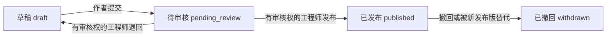

# 08 正式知识发布与检索设计

> 版本：v0.1，T03a文本版本/发布基础；日期：2026-10-30。
> 上游：[需求F1—F3](01-requirements.md)、[M3设计](07-m3-agent-design.md)。
> 本轮不接Embedding/pgvector索引、语义排序或Agent引用。文本已发布也明确返回formal_retrieval_available=false。

## 1. 阶段范围

T03a建立与信号CSV入口独立的知识版本、来源、行/字符锚点和应用审核记录。工程师明确选择组织或设备范围后上传UTF-8 MD/TXT；草稿私有，提交后仅有显式审核权限的工程师可审核，发布后按声明范围读取，撤回保留历史。

T03b接索引身份、真实Embedding、pgvector和授权检索；T03c再把正式检索与引用接入Agent。开发自编卡片不自动迁入正式知识，T03a的发布过滤不是向量检索或RAG效果验证。

## 2. 权限

| 操作 | 授权要求 |
| --- | --- |
| 导入/修订/提交 | 当前工程师角色；作者只能修改自己的文档；设备范围还需当前设备读取权 |
| 阅读草稿 | 作者且仍有工程师角色；未提交正文不向其他工程师开放 |
| 阅读待审核 | 作者或兼具工程师角色的当前审核授权持有人；仍检查设备范围 |
| 发布/退回/撤回 | 工程师角色＋管理员显式授予且未撤销的knowledge_review_grants；管理员角色本身没有业务发布权 |
| 阅读已发布/曾发布历史 | 当前点检员/工程师/主管业务角色；同组织及相应设备读取范围 |
| 授予/撤销审核权 | 当前管理员重新验证本人密码、CSRF、目标同组织；启用时目标须是活跃工程师；版本CAS＋幂等命令 |

审核权限不等于已验证的工程师职业资格；发布表示应用内审核动作，不认证来源、许可或故障结论。允许有显式权限的作者自审，事件记录self_review；不虚构第二位现场工程师。管理员兼任其他业务角色时，业务权限仍按显式角色/范围判定。

授权原文及下载不靠猜ID保护，每次重新检查会话、角色和范围。管理员审核权限变更要求1—1024字符密码输入，密码不进入命令摘要、事件、业务响应或日志；与登录共用基础尝试限流。

## 3. 输入、来源与资源边界

只收UTF-8 MD/TXT，≤5MiB，最多200000个按LF定义的行、4096块；超过任一上限明确拒绝。标题、来源说明、设备/部件适用范围、内容版本和使用授权说明必填；网址/作者可缺省。未知内容应在说明中明确，不补造标准/厂家出处。

content_origin区分developer_test、public_summary、vendor_authorized、internal_note，是用户声明而非独立证明。审核者负责判断声明是否足以发布。开发测试内容默认不进入正式发布候选过滤。

原始字节保存在PostgreSQL bytea，保留BOM和原始CRLF；另存去首BOM并将CRLF/CR规范为LF的文本及各自SHA256。正文不做HTML渲染、脚本执行、链接下载或文件路径解析。source_url只接受无用户凭据的http(s)引用，不自动访问。

组织范围需上传者明确选择，不因没有asset_id自动扩大共享。草稿仍是私有。重复检查仅针对同作者/同声明范围的规范化文本，避免向调用方透露他人私有文件是否存在；同键重放复用原版本，新键重复导入返回复用提示。另开版本需要明确文档版本CAS及理由。

## 4. 分块与引用

knowledge-lines-v1每块最多1800个Unicode码点，无重叠。按LF行贪心聚合，遇MD标题另起块；超长行按字符切分。代码围栏内的#不识别成标题。heading_path保存当前标题层级（展示标签最多256字符），正文仍完整保留。TXT中的#保持普通正文。

每块有稳定UUID、版本ID、块序号、标题路径、起止行（含端点）、字符区间[start,end)及文本SHA256。字符区间作用于规范化文本，不能当作原始UTF-8字节偏移。Unicode行分隔符不额外当作LF，避免行号与原文切片不一致。

版本正文、原始字节、来源声明、分块配置及块内容不可改写。读取块时核对正文切片、行号和hash；发布前核对完整来源与块数。新版本生成新块ID，旧引用不随新版本重排。

## 5. 数据与状态

0015新增6张业务表：knowledge_documents、knowledge_revisions、knowledge_chunks、knowledge_review_grants、knowledge_commands、knowledge_events。当前38张业务表，另有4张检查点表，pgvector扩展本轮未修改。

文档分开保存current_revision_id与published_revision_id：新草稿不替换旧发布版。新版本发布时，一个事务中撤回旧发布版并切换发布指针；直接撤回则清空当前发布指针，不自动恢复更早版本。撤回记录仍可由有范围权限的业务用户追溯，不参与新发布候选。

退回后正文重新私有，审核命令仅返回最小状态回执，不借命令重放泄露草稿。内容变更只能新建版本，范围/作者不可原地变更；revision_no、内容标签content_version和并发row_version分别保存，不混用。

需求中的处理中/失败由T03b索引运行状态补齐，不把Embedding失败伪装成文本发布失败。本轮4种文本状态与vector_index=not_integrated分开，索引失败/替换策略尚未实现。

## 6. API

路径统一以/api/v1/knowledge-documents开头，独立于旧原型/api/v1/knowledge/search。

| 方法/路径 | 内容 |
| --- | --- |
| POST 根路径 | multipart file＋metadata JSON；工程师、CSRF、Idempotency-Key |
| GET 根路径 | 当前授权版本分页；过滤权限后再分页 |
| GET /{document_id} | 作者/审核者按权限看当前版本；普通读者只得到当前发布版 |
| POST /{document_id}/revisions | 新file＋metadata，要求expected_document_version |
| GET /revisions/{id} | 版本/来源/审核身份/状态，不含全文或索引假结果 |
| GET /revisions/{id}/chunks | 授权块分页；每块有原文位置和hash |
| GET /chunks/{id} | 授权引用解析，包括撤回标记 |
| GET /revisions/{id}/original | 原字节下载，text/plain、attachment、nosniff |
| POST /revisions/{id}/submit,reject,publish,withdraw | 双版本CAS、理由、当前权限及幂等键 |
| POST /review-grants | 管理员密码复核、目标用户、enabled及授权版本CAS |

所有变更与追加事件/审计同事务。密码不纳入请求hash；认证仍对每次重放复核。相同命令重放返回当前状态，不能复活已撤销授权或重复发布。

## 7. 发布候选过滤边界

内部published_candidates只验证发布、范围和设备/部件适用元数据，最多5块，默认排除developer_test；它没有查询向量、相似度分数或召回评估，也没有公开搜索入口。返回块仍标formal_retrieval_available=false。

正式检索必须先按组织、当前设备权限、active publication、适用范围及索引身份过滤，再做排序；不能把无权内容先送入模型/排名再隐藏。撤回与权限变更后重新解析引用，历史读取与“可以用于新任务”分开。

## 8. T03b/T03c承接

本机只读检查显示PostgreSQL18.6可找到vector扩展，开发库当时未安装；不由应用账号自动CREATE EXTENSION。T03b先明确扩展启用及迁移账号边界，再接已有本地BGE-M3候选，保存真实模型digest、维度、分块/输入策略及索引版本。没有测量前不宣布ANN索引或召回阈值已定型。

索引以不可变源版本为输入，构建失败保留原可用发布/索引，完成后原子切换。检索记录查询、过滤、模型身份、实际命中及分数，相关性不作诊断概率；跨文档相同块需在已授权范围内去重，不能利用隐藏文档做可观察的重复提示。

T03c接Agent只读知识动作和真实knowledge_chunk引用，重查发布/撤回、权限、原文及索引身份；方法资料不成为设备采集证据。非可信正文不能扩大工具权限，DeepSeek动作选择仍由T04实现。

## 9. 本轮验证

见[T03a验收记录](acceptance/M3-T03a-verification.md)。覆盖原字节/锚点、权限/密码复核、重复/并发/版本CAS、发布替换与撤回、授权撤销、脚本/外链不执行、源内容不可变及空schema重建。实际HTTP另验证服务重启和历史块稳定，不以TestClient替代全部链路。

## 10. 下一步

进入T03b索引身份与授权向量检索，之后T03c接入Agent。知识前端、独立专业审核和共享试用准入仍归M4/M6，不用本机文本发布成功替代现场审核或RAG效果。
