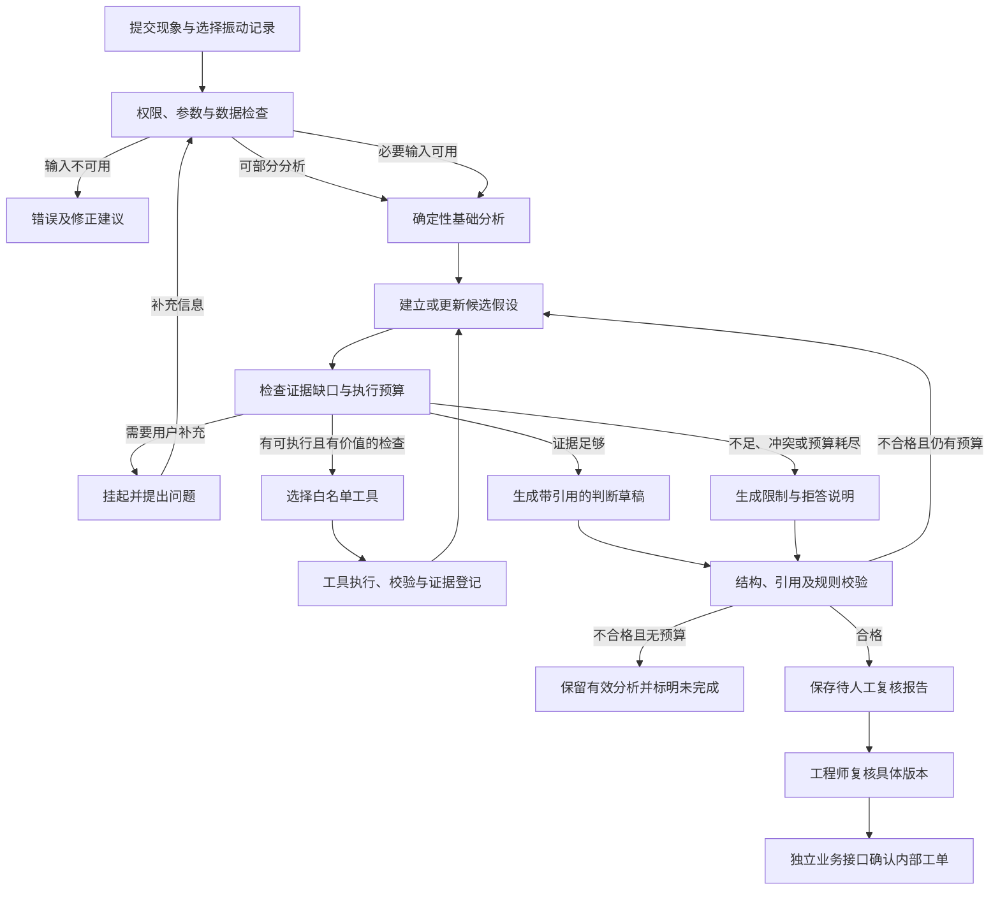

# 02 总体设计

> 归档维护（2026-10-30）：历史正文保留，相对链接按当前归档目录修正。

> 版本：v0.1（架构与 Agent 主流程草案）
> 上游：[需求规格 v0.9](../01-requirements.md)
> 状态：已明确模块边界与核心流程；数据模型、工具契约、API 和执行恢复细节待继续设计。已按用户要求提前建立本机最小模型验证原型，尚非完整实现。

## 1. 架构目标

VibraDiag 是以工业诊断 Agent 为核心的全栈应用。前端用于提交任务、观察分析并复核证据；后端提供可信数据和确定性工具；Agent 决定当前任务还需要什么证据，并在受约束范围内选择下一步。

首发采用模块化单体和单机部署方向，避免先拆微服务。界面、HTTP 服务、耗时任务执行和模型服务保持职责边界，是否拆独立进程在任务执行设计中确定。

## 2. 模块划分

| 模块 | 职责 | 不承担的职责 |
| --- | --- | --- |
| Web 工作台 | 上传、对话、图表、候选、工具进度、证据与复核 | 不在浏览器生成权威诊断或决定权限 |
| 业务 API | 身份/资源校验、数据关联、任务提交、结果读取、报告与确认写入 | 不依赖模型判断访问权限 |
| 分析工具层 | 质量检查、时域/频谱、包络、理论频率与峰匹配、可比记录查询 | 不靠模型计算数值、不直接发布维修工单 |
| Agent 编排层 | 澄清、假设、下一工具决策、冲突检查、终止与诊断草稿 | 不执行任意代码、不持有自主业务写权限 |
| 知识检索层 | 文档版本与审核、权限过滤、检索、块定位 | 不把相似文档当作当前设备测量事实 |
| 证据与发布校验 | 证据版本、适用条件、引用校验、报告版本与人工确认约束 | 不以模型自报高分代替有效性校验 |
| 持久化与运行支撑 | 文件、元数据、任务状态/检查点、审计、备份与配置 | 不用浏览器缓存代替任务事实 |

前期重点是分析工具、Agent 和最小工作台；完整业务权限与运行保障在共享试用前完成。存储模型从开始保留组织/用户、对象版本和来源，不因阶段后置而省掉边界。

## 3. 一次诊断的主流程

图中的“选择下一工具”由模型在工具描述、参数约束、候选和证据摘要基础上提出结构化请求，执行前由代码再次校验。工具缺少前置条件时不执行，不用模型补造参数。

工单不属于自主诊断循环。报告拒答、未复核、版本失效或审批未完成时，独立业务接口阻止创建。

## 4. 体现 Agent 能力的分支

| 观察或条件 | 合理的路径示例 | 验收关注点 |
| --- | --- | --- |
| 参数齐全且频谱出现待解释成分 | 根据候选请求包络或对应谐波检查 | 选择理由与证据缺口对应，不无差别执行所有工具 |
| 缺少本次采集转速 | 完成基础分析，追问转速；未知则限制依赖转速的任务 | 不用额定转速静默补齐 |
| 多个候选频率重合 | 请求能够区分假设的额外检查；不能区分则拒绝定类 | 保留反对证据与歧义 |
| 有历史记录但工况不同 | 先检查可比性，不直接算维修效果 | 工具前置条件有实际作用 |
| 无可靠知识命中 | 使用已有工具证据说明限制，不伪造手册引用 | RAG 为辅助知识，不强行命中 |
| 已无新信息或预算耗尽 | 保存有效结果并停止取证 | 不无限循环，也不自动变成“正常” |

这些是评测案例方向，不是固定的故障决策表。具体证据规则和频谱阈值需要独立定义、版本化并验证。

## 5. 状态与职责原则

- 分开管理对话会话、诊断任务、工具执行、证据、报告和工单；会话结束不等于全部对象完成。
- 诊断任务绑定数据/参数/知识/模型配置快照。用户修改依据后创建新版本或新任务，旧执行仍可追溯。
- 模型负责提出假设、选择工具、解释结果和请求补充；代码负责数值、条件校验、预算、权限、引用有效性及写入约束。
- 挂起等待用户不占用持续运行的工作进程；恢复后继续累计预算。执行中取消、失败与重启恢复在后续状态设计中明确处理。
- 工具执行记录既有业务可读摘要，也保留脱敏参数与结果引用；前端展示实际调用，不生成用于装饰的假轨迹。
- 前端通过任务状态和事件获取进度，断线后可从服务端重建；具体采用轮询或事件流在 API 设计中确定。

## 6. 技术选型方向

Python 确定性分析服务、FastAPI 和 LangGraph 是当前方向；选定具体版本、持久化方案与部署依赖前核对兼容性。数据库、检索索引、前端框架和队列通过数据量、恢复需求和维护成本选择，不为展示技术栈添加无实际用途的服务。

模型通过适配层接入，工具契约不依赖单一供应商。核心数值工具可在无模型环境独立运行；Agent 验收必须实际调用选定模型，不能用 mock 代替。

## 7. 后续需要完成的总体设计

1. 领域数据模型与对象版本：文件、采集记录、台账、任务、证据、知识、报告、工单和审计。
2. 工具输入输出契约、证据规则和失败分类。
3. 任务状态、持久检查点、并发队列、恢复/取消与副作用边界。
4. API、前端页面及权限矩阵的落地映射。
5. 具体技术选型、进程部署、数据卷、备份与可观测设计。
6. 需求到模块/测试的追溯，以及下一文档的版本里程碑。

完成以上内容后形成 `03-milestones.md`，复核 `04-first-iteration.md` 再进入正式分阶段实现。当前本机原型用于先验证工具调用与选型，不替代完整设计；模型实验记录见 [附录](model-selection.md)。
